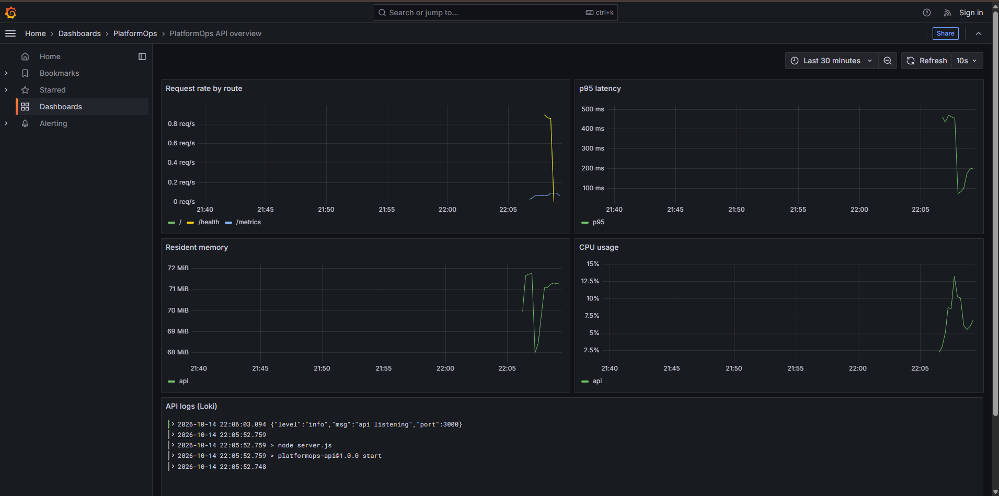
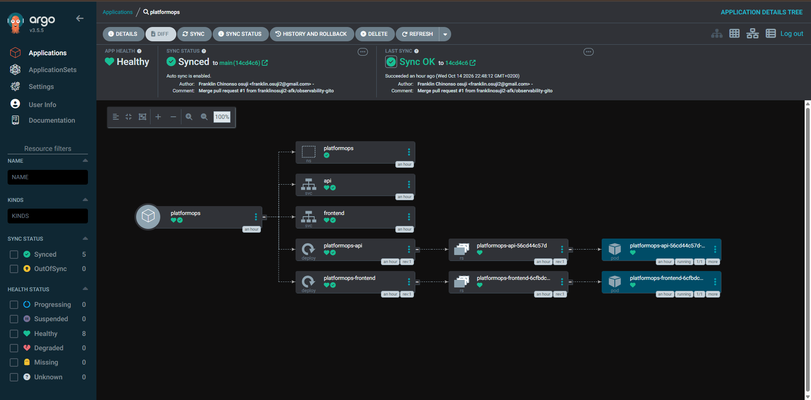

# PlatformOps-Lab

A local lab for practising infrastructure, delivery and observability without paid cloud resources. A small Node.js API and static frontend run in Docker Compose with Prometheus, Grafana and Loki, and the same app is deployed to a Kind cluster through Kustomize, with Argo CD (or Flux) pulling from this repository.

This is a personal learning project, not a production system.

## What is in the repository

| Area | What it does | Where |
| --- | --- | --- |
| Application | Express API with `/health` and Prometheus `/metrics`, plus an nginx-served frontend | `app/` |
| Compose stack | API, frontend, Prometheus, Grafana, Loki, promtail | `docker-compose.yml` |
| Observability | Prometheus scrapes the API, Grafana is provisioned with Prometheus and Loki datasources and one dashboard, promtail ships container logs to Loki | `monitoring/` |
| Kubernetes | Kustomize base and a `local` overlay | `kubernetes/` |
| GitOps | Argo CD `Application` (primary) and Flux `GitRepository` / `Kustomization` (alternative) | `gitops/` |
| Terraform | Kubernetes provider: creates the `platformops` namespace and an example nginx Deployment and Service on a Kind cluster | `terraform/` |
| Ansible | Preflight playbook that checks docker, kubectl, kind and terraform are installed | `ansible/` |
| CI | GitHub Actions: Compose, Kustomize and Terraform validation, image build, Trivy report, optional Snyk test | `.github/workflows/ci.yml` |

### Current limits

- Prometheus, Grafana and Loki run in the Compose stack. They are not deployed inside the Kind cluster yet.
- The Terraform example deploys a stock nginx, not this application. The application reaches the cluster through Kustomize and GitOps.
- Trivy reports HIGH and CRITICAL findings in the job summary but does not fail the build yet.
- Snyk runs only if a `SNYK_TOKEN` repository secret is set.
- There is no Helm chart in this repository yet.
- The Argo CD setup has been run on a local Kind cluster. The Flux manifests have not been run yet.

## Run it with Docker Compose

Requirements: Docker with Compose.

```bash
docker compose up --build
```

| Service | URL |
| --- | --- |
| Frontend | http://localhost:8080 |
| API | http://localhost:3000 (`/health`, `/metrics`) |
| Prometheus | http://localhost:9090 |
| Grafana | http://localhost:3001 (admin / admin, dashboard folder `PlatformOps`) |
| Loki | http://localhost:3100 |

Generate some traffic so the dashboard has data:

```bash
for i in $(seq 1 50); do curl -s localhost:3000/ > /dev/null; curl -s localhost:3000/health > /dev/null; done
```

Then open Grafana, `PlatformOps / PlatformOps API overview`. The log panel uses the Loki datasource with `{service="api"}`.

The result, from a local run of this stack (request rate, latency, memory, CPU and the API's logs from Loki):



Stop everything with `docker compose down`. Add `-v` to also remove the stored Grafana and Loki data.

The Grafana admin password is the default, so keep these ports on localhost only.

## Deploy to Kind

Requirements: Docker, Kind, kubectl.

```bash
kind create cluster --name platformops-lab
docker compose build api frontend
kind load docker-image platformops-lab-api:latest platformops-lab-frontend:latest --name platformops-lab
kubectl apply -k kubernetes/overlays/local
kubectl get pods -n platformops
```

Resource note: Kind with Argo CD needs more memory than Docker Desktop's default on a small machine. On a computer with 8 GB of RAM, a 3.9 GB WSL limit made `kube-controller-manager` and `kube-scheduler` crash-loop. Setting `memory=5GB` in `%USERPROFILE%\.wslconfig` and stopping the Compose stack while running the cluster fixed it.

## GitOps with Argo CD

See [gitops/README.md](gitops/README.md). In short: install Argo CD, apply `gitops/argocd/application.yaml`, and Argo CD keeps the cluster in sync with `kubernetes/overlays/local` on `main`. A Flux version of the same setup is in `gitops/flux/`.

Argo CD v3.5.5 on the local Kind cluster, synced to `main` and healthy, with the namespace, services, deployments and pods created from `kubernetes/overlays/local`:



## Terraform

```bash
cd terraform
terraform init
terraform validate
terraform plan
terraform apply
```

It uses `~/.kube/config`, so create the Kind cluster first. If you also applied the Kustomize overlay, the `platformops` namespace already exists. Run `terraform import kubernetes_namespace.platformops platformops` first, or use a fresh cluster.

## Ansible preflight

```bash
ansible-playbook ansible/playbooks/setup.yml
```

## CI

`.github/workflows/ci.yml` runs on pushes to `main` and on pull requests:

1. `validate`: `docker compose config`, `kubectl kustomize` for the base and the overlay, `terraform init -backend=false` and `terraform validate`.
2. `build-and-scan`: builds both images, runs Trivy (config and images) with results in the job summary, and runs a Snyk test of the backend when `SNYK_TOKEN` is set.

## Repository layout

```
.github/workflows/ci.yml
ansible/playbooks/setup.yml
app/{backend,frontend,nginx}
docker-compose.yml
docs/architecture.md
gitops/{argocd,flux}
kubernetes/{base,overlays/local}
monitoring/{prometheus,loki,promtail,grafana}
scripts/
terraform/
```

## Next steps

- Run Prometheus and Grafana inside the cluster (for example with the kube-prometheus-stack Helm chart, deployed by Argo CD).
- Make Trivy fail the build on HIGH and CRITICAL findings once the baseline is clean.
- Add resource requests and limits, probes and a non-root user to the Kubernetes manifests.
